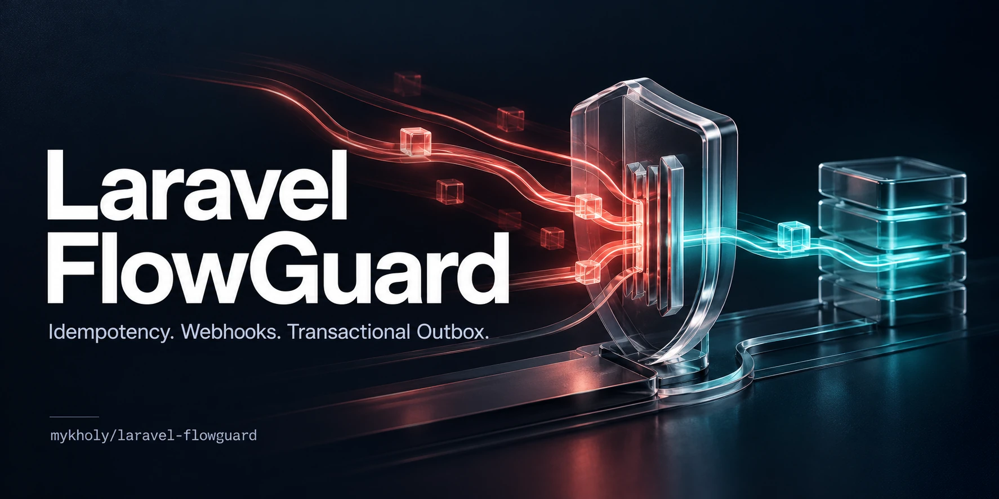

<p align="center">
  
</p>

# Laravel FlowGuard

**Durable operation ownership for requests, webhooks and background delivery.**

[](https://github.com/mykholy/laravel-flowguard/actions/workflows/ci.yml)
[](https://packagist.org/packages/mykholy/laravel-flowguard)
[](composer.json)
[](composer.json)
[](LICENSE)

A customer clicks **Pay** twice. A webhook arrives again. A worker dies after the
provider accepted its request. FlowGuard gives your application durable identities,
exclusive operation claims and explicit unknown outcomes so it can handle those
failures deliberately.

**Stable: [v1.0.2](https://github.com/mykholy/laravel-flowguard/releases/tag/v1.0.2).**
The [public API and storage contract](docs/PUBLIC_API.md) follow SemVer.

[Install](#installation) · [Payment example](#payment-example) ·
[Getting started](docs/GETTING_STARTED.md) · [Documentation](docs/README.md) ·
[Adoption checklist](docs/ADOPTION_CHECKLIST.md) ·
[Runnable demo](examples/checkout-demo/README.md)

## What it helps you build

| Your failure scenario | FlowGuard provides | You supply |
| --- | --- | --- |
| Two requests attempt the same payment or fulfillment | Scoped operation ownership and immutable payload fingerprints | Authorized tenant context and provider idempotency |
| A provider times out after possibly succeeding | Explicit reconciliation state and read-only evidence contracts | Provider lookup and outcome handling |
| A verified webhook arrives repeatedly | Durable inbox receipt and atomic outbox handoff | Signature verification and stable event identity |
| A database change commits but queue dispatch fails | Transactional outbox on the business connection | Atomic business write and event recording |
| A worker crashes after delivering a message | Expiring leases, fenced acknowledgement and bounded retries | Supervised publisher and destination deduplication |

Telescope, Horizon and Pulse help observe your application. FlowGuard coordinates
ownership and durable handoff inside the business workflow.

## Installation

```bash
composer require mykholy/laravel-flowguard:^1.0
php artisan migrate
php artisan flowguard:doctor
```

Laravel discovers the service provider and loads the migrations automatically.
The doctor checks local storage readiness. Follow the
[getting-started guide](docs/GETTING_STARTED.md) to choose an integration path.

| Dependency | Supported / verified versions |
| --- | --- |
| PHP | 8.3, 8.4, 8.5 |
| Laravel | 12, 13 |
| Database | SQLite, MySQL 8, PostgreSQL 16 |
| Package manager | Composer 2 |

To select a database connection, publish the configuration **before migrating**:

```bash
php artisan vendor:publish --tag=flowguard-config
```

Set `FLOWGUARD_DB_CONNECTION` to a configured Laravel connection. The default is
your application's default connection. Use durable transactional storage and the
same connection for business writes and outbox signals. Review
[upgrades](docs/PACKAGE_RELEASE.md) before changing an existing installation.

## Payment example

The following is an application integration sketch. `$gateway`, the authorized
merchant, order and amount come from your application; FlowGuard does not bundle
a payment gateway.

```php
use Mykholy\Flowguard\Flowguard;

// Resolve the merchant from authenticated, authorized application context.
$guard = app(Flowguard::class);
$operation = $guard->begin(
    scope: 'payments.capture',
    idempotencyKey: $merchantId . ':' . $orderId,
    payload: ['order_id' => $orderId, 'amount_minor' => $amountMinor, 'currency' => 'EGP'],
);

if (! $operation->acquired()) {
    // NEVER call the gateway from this branch.
    // Inspect $operation->operation->status and return an appropriate
    // API response (completed / already processing / manual reconciliation).
    return;
}

$claim = $operation->claim();
try {
    // The gateway must support its own idempotency key where available.
    $payment = $gateway->capture($orderId, $amountMinor, idempotencyKey: $merchantId . ':' . $orderId);
} catch (\Throwable $e) {
    // An exception after dispatch may mean the provider already charged.
    // Use provider-specific semantics for errors known to occur before dispatch.
    $guard->requireReconciliation($claim, 'capture_outcome_unknown');
    throw $e;
}

// Do not catch errors from complete() as if the provider capture failed.
// Persist local business writes atomically where required before this call.
// If finalization fails after capture, investigate without repeating the charge.
$guard->complete($claim, ['provider_reference' => $payment->reference]);
```

The caller must ensure errors before dispatch and known vs unknown outcomes are handled
according to provider semantics. A provider can charge successfully even when local
completion fails. Do not treat failed `complete()` as grounds for retrying the charge.
See [RFC-001](docs/RFC-001-CORE.md) and [threat model](docs/THREAT_MODEL.md).

## Webhooks and reliable delivery

Use only the primitives your workflow needs:

- **[Webhook inbox](docs/INBOX.md):** accept an already verified event once per
  tenant identity and payload, with an atomic outbox signal.
- **[Transactional outbox](docs/GETTING_STARTED.md#record-a-business-event):**
  record a durable signal alongside the business write on the same connection.
- **[Publisher integration](docs/PUBLISHING.md):** bind your own
  `OutboxPublisher`, then run an explicitly supervised delivery worker.
- **[Reconciliation](docs/RFC-002-READ_ONLY.md):** inspect unknown outcomes;
  optional evidence journaling and manual classification require host policies.

There is no automatic publisher schedule. After binding your publisher, one
bounded delivery attempt is available through:

```bash
php artisan flowguard:dispatch-once --lease=60 --retry=60 --max-attempts=10
```

Consumers must deduplicate by message identity. A worker can crash after remote
acceptance and before local acknowledgement, causing redelivery. Configure the
publisher's timeout shorter than its lease. See [delivery semantics](docs/PUBLISHING.md).

## Diagnostics and operations

```bash
php artisan flowguard:doctor
php artisan flowguard:stale --minutes=15 --limit=50
php artisan flowguard:outbox --max-attempts=10 --limit=50
```

These commands inspect state. A stale processing claim remains fenced; age never
authorizes repeating a payment. Start with the [operations runbook](docs/OPERATIONS.md)
for incidents, [retention](docs/RETENTION.md) for data handling and
[restore drills](docs/NATIVE_RESTORE_DRILL.md) for recovery.

## Documentation

| Start here | Read next |
| --- | --- |
| [Getting started](docs/GETTING_STARTED.md) | Installation, operation claims and atomic event recording |
| [Documentation index](docs/README.md) | Guides grouped by integration, operations and design |
| [Public API](docs/PUBLIC_API.md) | Supported calls, named parameters and compatibility rules |
| [Checkout demo](examples/checkout-demo/README.md) | Isolated Laravel host, signed webhooks and failure exercises |
| [Verification evidence](docs/STABLE_READINESS.md) | Release checks, measured workloads and evidence boundaries |

## Guarantees and integration boundaries

- Database uniqueness arbitrates claims; duplicate callers never receive another
  caller's owner capability. Changed payloads conflict instead of silently replaying.
- Unknown outcomes remain blocked. Processing claims have no automatic TTL reclaim.
- Outbox delivery is **at least once**. Exactly-once external effects are not guaranteed.
- Your application owns authentication, tenant isolation, signature verification,
  provider idempotency, timeouts, approval identities and retention.
- Store bounded safe metadata and opaque references; keep credentials and raw
  provider bodies out of package records.

The stable version commits to library compatibility. Independent human security
and adopter reviews remain open. See [security](SECURITY.md),
[tenant boundaries](docs/TENANT_BOUNDARIES.md) and [release scope](docs/RELEASE_CRITERIA.md)
for the precise contract.

## Development and contributions

```bash
composer install
composer validate --strict
composer test
composer analyse
composer format-check
php tests/smoke.php
node --test tools/check-preview-release.test.cjs
```

CI covers Laravel/PHP compatibility, independent SQL workers, archive-based
installation, demo-host behavior and native restoration. See
[concurrency testing](docs/CONCURRENCY_TESTING.md) and [contributing](CONTRIBUTING.md).
Report private security issues through [SECURITY.md](SECURITY.md).

MIT © 2026 Ahmed El-Kholy.
